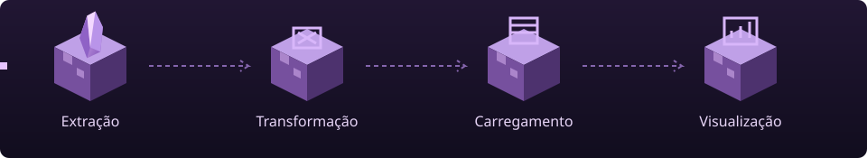

 

## ✦ 01 / Sobre mim

Sou estudante de **Análise e Desenvolvimento de Sistemas na FMU** e jovem aprendiz na área de **Dados e ETL no Santander**.

Minha experiência envolve tratamento, organização e validação de dados, com interesse em automação de processos, análise de dados e inteligência artificial.

Busco desenvolver soluções que transformem informações em resultados úteis, unindo tecnologia, criatividade e aprendizado contínuo.

- **Atuação:** Dados, ETL e automação
- **Estudos:** Python, SQL e computação em nuvem
- **Idiomas:** Português e japonês

 

## ✦ 02 / Tecnologias

        

## ✦ 03 / Dados em transformação

Do dado bruto à informação: organizar, validar, transformar e visualizar para apoiar decisões.

## ✦ 04 / Projetos

| Projeto | Descrição | Tecnologias |
| :--- | :--- | :--- |
| [**Automação de Relatórios**](https://github.com/gigicay/automacao-relatorios) | Sistema para importar arquivos CSV, tratar dados, gerar dashboards interativos e exportar relatórios em Excel. [Acessar aplicação](https://automacao-relatorios.streamlit.app/) | Python · Pandas · Streamlit · Plotly |
| **ColorAble** | Projeto de estudo voltado à avaliação de paletas de cores e acessibilidade para deuteranopia. | Python · UX/UI |
| **Bancopy** | Projeto de estudo de um sistema bancário simulado com operações e persistência de dados. | Python · JSON |

## ✦ 05 / Formação e aprendizado

- Graduação em Análise e Desenvolvimento de Sistemas — FMU (em andamento)
- Design UX/UI — SENAI
- Estudos em arquitetura de nuvem — AWS Academy
- Desenvolvimento de projetos de dados e automação com Python

## ✦ 06 / Atividade no GitHub

 

---

<em>✦ Construindo meu futuro, bloco por bloco. ✦</em>

