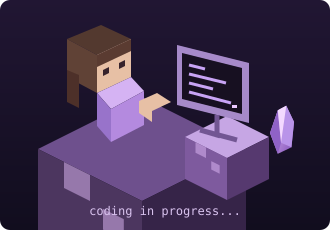
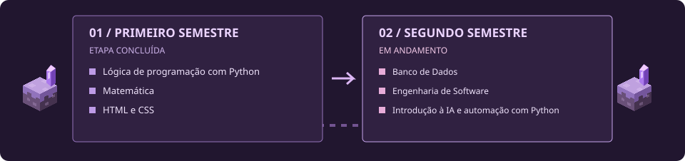
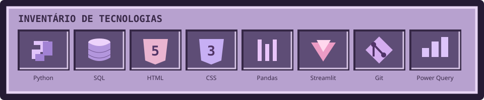

## ✦ 01 / Sobre mim

Sou estudante de **Análise e Desenvolvimento de Sistemas na FMU** e jovem aprendiz na área de **Dados e ETL no Santander**.

Atuo no tratamento, organização e validação de dados. Tenho interesse em automação, inteligência artificial e desenvolvimento de soluções que facilitem processos e transformem dados em informações úteis.

Minecraft marcou minha infância e inspira a identidade visual deste perfil: aprender, explorar e construir, um bloco de cada vez.

 

## ✦ 02 / Minha jornada acadêmica

Disciplinas por semestre

**1º semestre — Concluído**
- Lógica de Programação na linguagem Python
- Matemática
- HTML e CSS

**2º semestre — Em andamento**
- Banco de Dados
- Engenharia de Software
- Introdução à IA e Automatização com Python

## ✦ 03 / Ferramentas e tecnologias

## ✦ 04 / Do dado bruto à informação

## ✦ 05 / Projeto publicado

### Automação de Relatórios

Aplicação desenvolvida para facilitar o processamento e a análise de dados de relatórios. Permite importar arquivos CSV, padronizar e validar dados, visualizar indicadores em dashboards interativos e exportar resultados em Excel.

**Tecnologias:** Python, Pandas, Streamlit, Plotly e OpenPyXL.

## ✦ 06 / Próximos blocos

- Aprofundar meus conhecimentos em banco de dados e SQL.
- Explorar aplicações de inteligência artificial com Python.
- Desenvolver novos projetos de automação e análise de dados.

## ✦ 07 / Atividade no GitHub

 

---

<em>✦ Sempre aprendendo. Sempre construindo. ✦</em>

